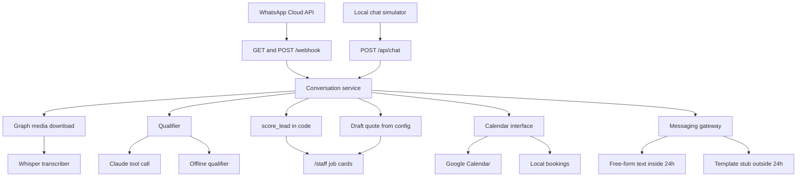
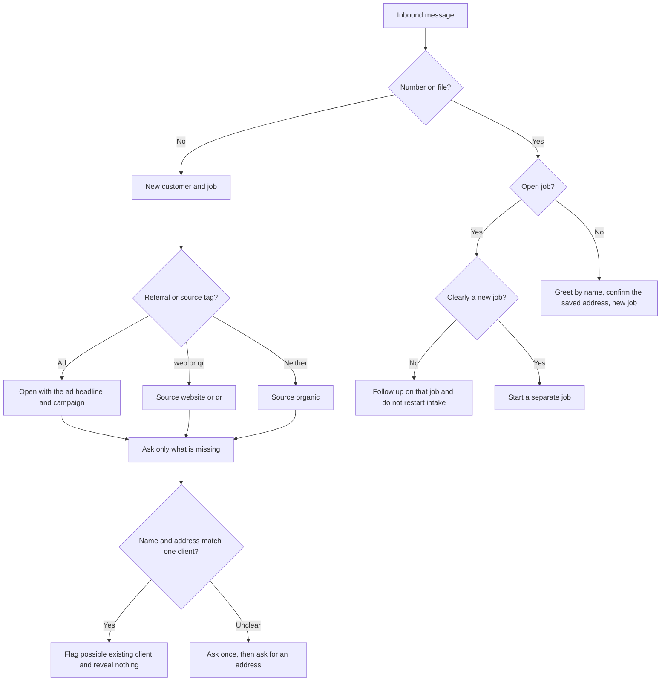

# WhatsApp Tradie Bot

Repository: https://github.com/shishirven/whatsapp-tradie-bot

A WhatsApp assistant for an Australian trade business. Electricians first: a customer messages the business number, the bot collects the job (type, suburb, urgency, description, photos, a preferred time, and a name), offers three free visit slots, and hands the thread to the desk when the job is urgent or a good fit. Draft price ranges stay on the staff desk until a person sends them.

The trade is config. Edit `config/business.json` — business name, service-area suburbs, job types, hours, and draft price bands — and the same app serves another trade. Northside Electrical in that file is sample config, not a live tariff.

## Architecture



## Routing

Every inbound message goes through one decision, before intake:



A number is known when it is already in `customer_numbers` — including clients imported from CSV. An open job is `open`, `quoted`, or `booked`. `completed` and `cancelled` are closed, so the next message starts a new job.

Follow-up on an open job answers a status question from that job's booking, attaches a photo or voice note, or hands the chat to the tradie. It does not run the intake questions again after handoff. "Clearly a new job" is classified by Gemini when `LLM_PROVIDER=gemini`, and by Claude when `LLM_PROVIDER=anthropic`. With no key, a phrase list is the stand-in (`different job`, `another job`, and similar). Tests pass a fake classifier and never call Gemini or Anthropic.

Job source is one of `ad`, `organic`, `website`, `qr`, or `repeat`. A Meta referral is `ad`, and the first reply names the headline and campaign. A configured prefilled tag in `config/business.json` (`(web)`, `(qr)`, and whatever you add under `source_tags`) sets `website` or `qr` and is removed before the qualifier reads the text. A known number with neither is `repeat`. Anything else is `organic`.

A brand-new number is not told that it matches anyone. If the name and address they give match exactly one saved customer, the job is flagged **possible existing client** for the desk. The bot does not say it knows them, and it does not mention that customer's other jobs, quotes, addresses, or bookings. If the name matches but the address does not, the bot may ask once: "Have we done work for you before?" A yes is followed by "What address did we do that work at?" Staff confirm the match by linking the number. Until then the number stays its own customer.

## Scoring

Scoring is not left to the model. `app/scoring.py` decides hot, warm, and cold from the business config.

| Score | Rule |
| --- | --- |
| Cold | No job type yet |
| Warm | A job type is known, but the suburb is outside the service area, or urgency, description, or a name is still missing |
| Hot | An emergency inside the service area, or a configured job type with an in-area suburb, urgency, description, and a name |

Handoff happens when the score is hot, or when the customer asks for a person, at any score. After that the bot stops extracting on that job. A slot the customer already picked can still be booked. A later message that is clearly a new job starts intake again. One chat thread is kept per phone number. A customer can have several numbers and several jobs.

Quotes are a min–max range from `config/business.json`. They are saved as drafts. The bot never puts a dollar amount in a customer reply. Someone on `/staff` approves the draft, and only then is it sent.

Visit times come from `Calendar`. With Google credentials that is the Calendar API (service account or OAuth). Without them, bookings live in SQLite so the simulator still works. The customer is offered the next three free slots inside the configured hours, and the slot they pick is booked.

Gemini is the recommended reader. It calls `record_job_intake` on every turn (`function_calling_config` mode ANY) and returns the WhatsApp reply plus the job facts. The same scrubber removes any sentence that still contains a price before send. A free-tier 429, or any other Gemini error, uses the offline qualifier for that turn so the webhook still answers.

Electrical hazards are checked twice on every turn. `app/hazards.py` holds keyword rules (fallen or exposed wires, powerlines, a person stuck to the power, shocks and tingles, fire, water near electrics, overheating, swollen batteries, and whole-street outages). `record_job_intake` also returns a `hazard` field (`none`, `wire`, `powerline`, `shock`, `person_down`, `fire`, `water`, `overheating`, `battery`, or `street_outage`). Either side can raise a hazard and the model cannot lower one. When both find one, the rules choose. The hazard picks a fixed safety reply from `app/policy.py`; the model never writes the safety advice. Each disagreement is logged as `hazard disagreement rules=... model=...` so missed phrasings can be added to the rules.

Claude stays available. Sonnet 5.5 does not accept a forced tool choice (`tool_choice` of `any` or `tool` returns 400). That call uses `tool_choice: auto`, a strict schema, and a prompt that tells the assistant to call `record_job_intake` every turn. `thinking` is `between_tools`. If the model replies in plain text anyway, that text is sent and no new facts are stored.

With no API key, `LLM_PROVIDER` defaults to `mock`: a keyword extractor in `app/extract.py`. It is there so you can click through the product. It is not the reader you ship. If `LLM_PROVIDER` is unset and `GEMINI_API_KEY` is set, Gemini is selected. An Anthropic key alone still selects Claude.

## Run it locally

```bash
python -m venv .venv
source .venv/bin/activate
pip install -r requirements.txt
cp .env.example .env
uvicorn app.main:app --reload
```

On Windows, activate with `.venv\Scripts\activate`.

Open [http://127.0.0.1:8000](http://127.0.0.1:8000). Pick a sample ad, chat, and watch the job card. The desk is [http://127.0.0.1:8000/staff](http://127.0.0.1:8000/staff). Interactive API docs are at `/docs`.

To answer with Gemini, create a free key at [Google AI Studio](https://aistudio.google.com/apikey) and set:

```bash
LLM_PROVIDER=gemini
GEMINI_API_KEY=...
```

The default model is `gemini-3.8-flash` (`GEMINI_MODEL`). On Render, set `GEMINI_MODEL=gemini-3.5-flash-lite` and `GEMINI_FALLBACK_MODELS=gemini-3.1-flash-lite`. `gemini-3.8-flash` was returning 503 and 504, and `gemini-3.8-pro` is 404 on a free key. A 404, 429, 503, or 504 tries the next model in that list. The keyword qualifier is used only after every model in the list has failed. The log line `gemini qualify answered with model ...` names the model that answered. Each request still waits at most 20 seconds and is not retried on the same model. A 404 is logged with the model id and the name `GEMINI_MODEL`. Free-tier limits are per Google project, not per key, and the live numbers are on the AI Studio rate-limit page. A project checked in October 2026 showed Flash-class models around 5 requests per minute, 250,000 input tokens per minute, and 20 requests per day, resetting at midnight Pacific. Those figures are not a guarantee. Each open-job message can use two calls (new-job check, then intake), so a busy day falls back to the offline qualifier instead of dropping the message.

To answer with Claude instead:

```bash
LLM_PROVIDER=anthropic
ANTHROPIC_API_KEY=sk-ant-...
```

The Claude model is `claude-sonnet-5-5` (`ANTHROPIC_MODEL`).

Tests do not call Anthropic, Gemini, OpenAI, Meta, or Google. They pass fakes:

```bash
pytest
```

## Evals

Golden conversations live in `evals/golden_set.yaml` (30 cases). Placeholders such as `{owner_name}`, `{price_range}`, `{callout_fee}`, and `{slot}` are filled from `evals/fixtures/test_business.json` and from the calendar when the run starts. That file is a fake business: the name, licence, fees, and price bands are examples, not a live tariff. Client records used by the returning-customer cases are in `evals/fixtures/clients.json`. If a configured value is missing, the bot says it will confirm it and does not invent a figure.

Offline, deterministic checks only (no API key, mock qualifier):

```bash
python -m evals.run --offline
```

With `GEMINI_API_KEY` set, the same command sends each case through the real Gemini qualifier and then grades the reply with a separate judge. `GEMINI_MODEL` is the reply model. `JUDGE_MODEL` is the judge and defaults to `gemini-3.1-flash-lite`, which answers on the free tier. Hard-rule checks (000, the price book, DIY steps, refunds and fault, fabricated config, stored client details, the escalation flag) are code. They do not call the judge. A configured call-out fee or price-book range is not a fixed price.

```bash
python -m evals.run
python -m evals.run --repeats 3 --rpm 5
```

`--rpm 5` waits so Gemini is called at most five times a minute. Use that on the free tier. `--repeats N` runs every case N times. A case whose overall verdict, deterministic verdict, or judge verdict is not the same on every repeat is marked unstable.

Reports are written to `evals/results/` as JSON and Markdown. That directory is gitignored.

Human calibration labels live in `evals/human_labels.yaml`. Each case starts as `pass: null` and `note: TODO`.

```bash
python -m evals.calibrate
python -m evals.calibrate --results evals/results/latest.json
```

That prints the agreement percentage and every labelled case where the human and the judge disagree. Unlabelled cases are skipped.

To add a case, append it to `evals/golden_set.yaml` with an id, category, customer message, reference reply, and rule. Add any setup (photo, returning client, unknown number) under `setup`. Add a TODO row to `evals/human_labels.yaml`. Register the case's deterministic checks in `CASE_CHECKS` inside `evals/checks.py`.

Pytest runs the offline harness, so CI does not need an API key.

### Docker

```bash
docker build -t whatsapp-tradie-bot .
docker run --rm --name whatsapp-tradie-bot -p 8000:8000 --env-file .env -v whatsapp-tradie-data:/data whatsapp-tradie-bot
```

The image stores SQLite at `/data/tradie.db`. Leave `SQLITE_PATH` commented out in `.env` so that path is not overridden. The process listens on `PORT` (8000 if unset).

## Unclear messages

Before intake reads a message, `app/clarity.py` decides whether it is a clear request for electrical work. On every turn, the model's `record_job_intake` call also returns an `intent` and, when needed, a `clarifying_question`. The possible intents are:
- `service_request`
- `answer`
- `question`
- `follow_up`
- `greeting`
- `vague_request`
- `unclear`
- `not_electrical`

| Message | Intent | What happens |
| --- | --- | --- |
| "hha", "asdf", "?" | unclear | The bot asks what they need an electrician for, with examples. Nothing is stored. |
| "need an electrician" | vague_request | The bot asks what the electrical job is. Only confirmed facts are kept, such as a configured suburb. |
| "my toilet is blocked" | not_electrical | The bot politely says it's electricians only. No job is created. |
| "do you work weekends?", "hi", "I want a full refund" | question / greeting | The reply stands, but free text is never stored as a job type or suburb. |

Who decides, strongest first:
1. **Deterministic evidence:** a hazard, a guardrail reply, a configured job word, a slot or menu number, a configured suburb when the suburb was asked, a visit or cancel request, or a request for a person.
2. **The model's `intent`.**
3. **Keyword rules,** used offline.

The rules can overrule the model only in the direction of asking, for example when gibberish is labelled as a job.

If a customer sends a second unclear message in a row, the bot replies with a numbered menu of the configured jobs. A third hands the chat to a person (`unclear_request`), and the owner is alerted. Each clarifying turn is recorded in `llm_calls` as `policy_rule = clarify:<intent>`. The `summary` command counts these turns and the model's intents.

## Owner alerts

When a customer reports a hazard, complains, asks for a person, or becomes a hot lead, the bot sends an alert to the owner's own WhatsApp:

```
URGENT SAFETY: possible live wire
Job: #12, Fault finding and power loss, Newtown, emergency
Customer: Sam +61 412 345 678
They said: "live wire hanging nearby"
Open the job: https://<your app>/staff/12
```

Alerts go out in the background, so the customer's reply is never delayed. The same job and reason alert at most once every 30 minutes. Messages from the owner's number get no customer reply. A failed alert is logged as `owner alert FAILED` with Meta's error code.

Settings:

| Variable | Example |
| --- | --- |
| `OWNER_WHATSAPP` | `+61412345678`, the owner's own number, not the bot's. Empty means alerts are log lines only. |
| `OWNER_ALERT_TEMPLATE` | `owner_job_alert`, the approved template below |
| `OWNER_ALERT_LANGUAGE` | `en`, the template's language code |
| `PUBLIC_BASE_URL` | `https://whatsapp-tradie-bot.onrender.com`, used for the staff-desk link |

WhatsApp only allows free text to someone who has messaged the business number in the last 24 hours, so alerts need an approved **utility** template. In WhatsApp Manager, go to **Message templates** and choose **Create template**. Set the category to **Utility**, the name to `owner_job_alert` and the language to **English**, then use this body:

```
Job alert from your WhatsApp assistant: {{1}}
Job: {{2}}
Customer: {{3}}
They said: "{{4}}"
Open the job: {{5}}
Please contact the customer as soon as you can.
```

Sample values for the review:
- {{1}}: `URGENT SAFETY: possible live wire`
- {{2}}: `#12, Fault finding and power loss, Newtown, emergency`
- {{3}}: `Sam +61 412 345 678`
- {{4}}: `live wire hanging nearby`
- {{5}}: `https://example.com/staff/12`

Until the template is approved, leave `OWNER_ALERT_TEMPLATE` empty. Alerts then go as free text and arrive only if the owner has messaged the bot's number in the last 24 hours. While the Meta app is in development mode, add the owner's number as an allowed recipient.

## Model calls, logs and traces

Every customer message the bot answers writes one row to the `llm_calls` table. The row records:
- **Who answered:** Gemini, Claude, or the offline stand-in, and the exact model.
- **Timing and cost:** response time and tokens.
- **Each attempt:** every fallback hop and its error.
- **The output:** the model's raw tool output, the reply it wrote, and the reply actually sent.
- **Hazards and guardrails:** the keyword and model hazard verdicts, and which guardrail rule replaced the reply (for example `safety:wire` or `price`).
- **Versions:** a `prompt_version` id for the prompt template, business config and tool schema.

Each distinct system prompt is stored once in `prompts`, so a turn can be replayed against a new prompt. Writing a record never blocks a reply.

```bash
python -m app.llm_log summary                    # volume, fallback rate, p50/p95 latency, tokens, hazards, disagreements
python -m app.llm_log --since 2026-11-01 export calls.jsonl   # one row per turn, with empty label/note for error analysis
```

Copy to S3: set `LOG_BUCKET`, `AWS_ACCESS_KEY_ID` and `AWS_SECRET_ACCESS_KEY` (an IAM user that can only reach that bucket) and `AWS_REGION` (default `ap-southeast-2`). Every 5 minutes (`LOG_SHIP_INTERVAL_SECONDS`), new rows are uploaded as gzipped JSON Lines to `s3://<LOG_BUCKET>/llm_calls/dt=YYYY-MM-DD/<first id>-<last id>.jsonl.gz`. A failed upload is retried and no rows are skipped. The files hold customers' words and the replies sent, so keep the bucket private.

```bash
python -m app.llm_log s3-check   # write, read back and delete a test file: proves the keys and bucket work
python -m app.llm_log ship       # upload everything new right now
```

Logs: the app's own `tradie.*` loggers print to stdout at `LOG_LEVEL` (default `INFO`). Each turn logs one line, `turn {...}`, with the same summary. That line has no phone number or message text.

Traces: set `OTEL_EXPORTER_OTLP_ENDPOINT` (and `OTEL_EXPORTER_OTLP_HEADERS` if the backend needs a key) to send OpenTelemetry traces to any OTLP backend, such as Langfuse, Arize Phoenix, Grafana or Honeycomb. Each message is a `whatsapp.turn` span with a `chat <model>` child that uses the GenAI semantic conventions (`gen_ai.provider.name`, `gen_ai.response.model`, `gen_ai.usage.*`). The `tradie.turn_id` attribute matches the `llm_calls` row. Spans carry no phone numbers or message text. With no endpoint set, tracing is off.

## Regression set

`evals/regression_set.yaml` holds about 60 short conversations, each pinning one behaviour. Most come from bugs found in live use; each case's `why` line says which. The owner's golden set is single messages with reference replies, and it stays as written. Regression cases are multi-turn: Riley greets, then each customer message is sent in turn. Code checks look at the reply and at what was stored on the job, for example:
- `stores_nothing`, `job_type`, `suburb`
- `asks_about`, `one_question`, `mentions_000`, `no_echo`
- `handoff_reason`, `alerts`, `booked`

A turn with a `model:` block replays a recorded Gemini output (such as `\u2013` in a time), so the app's handling of a model quirk is tested without calling a model. The cases run against a pinned copy of the business config (`evals/fixtures/regression_business.json`).

```bash
python -m evals.regression --offline                  # what CI runs (also via pytest)
python -m evals.regression                            # adds live Gemini when GEMINI_API_KEY is set
python -m evals.regression --category vague_request --repeats 3 --rpm 5
```

Live results are reported per category as pass, fail, unstable (the verdict flipped between repeats) or fallback (Gemini failed and the offline qualifier answered). The report is written to `evals/results/regression_latest.md`. When a real conversation goes wrong, add it as a case.

## Render

`render.yaml` is a Docker web service on the **Starter** plan. Starter is paid and does not sleep, so Meta can reach the webhook. A free web service spins down and drops verification and message retries.

The health check is `GET /api/health`. A 1 GB disk is mounted at `/data` for SQLite and downloaded photos and voice notes.

1. Push this repo to GitHub.
2. In Render, create a Blueprint and point it at the repo. Render reads `render.yaml`.
3. Fill the environment variables it prompts for (see the table below). `STAFF_SESSION_SECRET` is generated.
4. Deploy. The service URL is `https://<service>.onrender.com`.
5. In Meta, set the callback URL to `https://<service>.onrender.com/webhook`.

### Live app

The deployed service is https://whatsapp-tradie-bot.onrender.com (if Render added a suffix to the name, the exact URL is at the top of the service page in the dashboard).

| Page | URL |
| --- | --- |
| Chat simulator | https://whatsapp-tradie-bot.onrender.com/ |
| Staff desk (sign in with `STAFF_USERNAME` / `STAFF_PASSWORD`) | https://whatsapp-tradie-bot.onrender.com/staff |
| Health check | https://whatsapp-tradie-bot.onrender.com/api/health |
| Meta webhook callback | https://whatsapp-tradie-bot.onrender.com/webhook |

Gemini on Render: `GEMINI_MODEL=gemini-3.5-flash-lite` and `GEMINI_FALLBACK_MODELS=gemini-3.1-flash-lite`. Both are in `render.yaml`; set them under the service's **Environment** tab if the service was not created from the Blueprint.

`MESSAGING_PROVIDER` is `whatsapp` and `LLM_PROVIDER` is `gemini` in the blueprint. Until `WHATSAPP_TOKEN` and `PHONE_NUMBER_ID` are set, outbound sends are skipped and logged; inbound messages are still stored. Until `GEMINI_API_KEY` is set, the reply says that key is empty.

## Environment variables

| Variable | Purpose |
| --- | --- |
| `WHATSAPP_TOKEN` | Permanent system-user token for the Cloud API |
| `PHONE_NUMBER_ID` | WhatsApp phone number id. `WHATSAPP_PHONE_NUMBER_ID` is also accepted |
| `VERIFY_TOKEN` | String you type into the Meta webhook form. `WHATSAPP_VERIFY_TOKEN` is also accepted |
| `APP_SECRET` | Meta app secret. When set, `POST /webhook` must carry a valid `X-Hub-Signature-256`. `WHATSAPP_APP_SECRET` is also accepted |
| `GEMINI_API_KEY` | Gemini. Required when `LLM_PROVIDER=gemini`. Free key from [AI Studio](https://aistudio.google.com/apikey) |
| `GEMINI_MODEL` | Reply model. Defaults to `gemini-3.8-flash`. On Render use `gemini-3.5-flash-lite` |
| `GEMINI_FALLBACK_MODELS` | Comma-separated models tried after a 404, 429, 503, or 504. On Render: `gemini-3.1-flash-lite` |
| `JUDGE_MODEL` | Eval judge only. Defaults to `gemini-3.1-flash-lite` |
| `ANTHROPIC_API_KEY` | Claude. Required when `LLM_PROVIDER=anthropic` |
| `ANTHROPIC_MODEL` | Defaults to `claude-sonnet-5-5` |
| `OPENAI_API_KEY` | Whisper. Voice notes are stored without a transcript until this is set |
| `WHISPER_MODEL` | Defaults to `whisper-1` |
| `GOOGLE_SERVICE_ACCOUNT_JSON` | Service-account key JSON, as one line. Share the calendar with that account's email |
| `GOOGLE_APPLICATION_CREDENTIALS` | Or a path to the same JSON file |
| `GOOGLE_OAUTH_CLIENT_ID` | OAuth client, if you are not using a service account |
| `GOOGLE_OAUTH_CLIENT_SECRET` | OAuth client secret |
| `GOOGLE_OAUTH_REFRESH_TOKEN` | Refresh token with Calendar scope |
| `GOOGLE_CALENDAR_ID` | Calendar to read and write. Required when either Google path is set |
| `STAFF_USERNAME` | Desk login. Both username and password must be set or `/staff` stays open |
| `STAFF_PASSWORD` | Desk password |
| `STAFF_SESSION_SECRET` | Signs the session cookie. Render generates one |
| `BUSINESS_CONFIG` | Optional path to a different `business.json` |
| `SQLITE_PATH` | Defaults to `data/tradie.db`. On Render, `/data/tradie.db` |
| `MESSAGING_PROVIDER` | `simulated` or `whatsapp` |
| `LLM_PROVIDER` | `gemini` (recommended), `anthropic`, or `mock` |

Use either the service account or the OAuth trio. If both are set, the service account wins. If neither is set, slots are booked into SQLite only.

## Meta setup you do by hand

The app cannot create a Meta business or approve templates.

1. **Business verification.** In [Meta Business Manager](https://business.facebook.com/), create or claim the business and complete business verification. An unverified business cannot use a production WhatsApp number for long.
2. **App and WhatsApp product.** In [Meta for Developers](https://developers.facebook.com/), create an app, add WhatsApp, and attach a WhatsApp Business Account and a phone number. Copy the phone number id into `PHONE_NUMBER_ID`.
3. **Token.** Create a system user with the WhatsApp permission and a permanent token. Put it in `WHATSAPP_TOKEN`. A temporary dashboard token expires.
4. **App secret.** Copy the app secret into `APP_SECRET`. `POST /webhook` then rejects any body whose `X-Hub-Signature-256` is not `sha256=` plus HMAC-SHA256 of the raw body.
5. **Webhook.** Callback URL `https://<your-host>/webhook`, verify token equal to `VERIFY_TOKEN`. Subscribe the app to the **messages** field. Meta's handshake is `GET /webhook?hub.mode=subscribe&hub.verify_token=...&hub.challenge=...`; the response body is the challenge as plain text.
6. **Templates.** Outside the 24-hour window the app sends template names `booking_confirmation` and `quote_followup`. Those are stubs. Create and approve templates with those names in WhatsApp Manager, or change the constants in `app/window.py` (they are marked TODO) to the approved names. Until then, an outside-window send is rejected by Meta and the quote stays a draft if the API errors.

Status callbacks (`delivered`, `read`) are acknowledged and ignored. The same message id posted twice is stored once.

## Google Calendar you do by hand

1. In Google Cloud, enable the Calendar API.
2. Create a service account and download the JSON. Put the JSON on one line in `GOOGLE_SERVICE_ACCOUNT_JSON`, or mount the file and set `GOOGLE_APPLICATION_CREDENTIALS`.
3. In Google Calendar, share the tradie's calendar with the service-account email, with permission to change events.
4. Set `GOOGLE_CALENDAR_ID` to that calendar's id.

OAuth is the other path: a client id, secret, and refresh token that already has `https://www.googleapis.com/auth/calendar`. No browser flow runs inside the app.

## Staff desk

`/staff` lists job cards: type, suburb, urgency, description, photos, voice-note transcript and summary, the offered or booked visit, the job status and source, and the draft quote. **Approve and send quote** is the only way a price leaves the building.

`/staff/customers` lists each customer with their numbers, addresses, notes, and jobs. A job flagged as a possible existing client can be linked to that customer, which moves the new number and its jobs onto the saved record. On a job you can split a message onto a new job, move a message to another job of the same customer, or set the status to completed or cancelled.

Import existing clients from the desk (CSV upload) or from the shell:

```bash
python -m app.import_clients clients.csv --dry-run
python -m app.import_clients clients.csv
```

The file needs `name` and `phone` columns. `address` and `notes` are optional. Several numbers can sit in the phone cell, separated by `;` or `/`. `0412 345 678` is stored as `61412345678` — WhatsApp's country code plus number, with no plus sign. `--db` overrides `SQLITE_PATH`.

Set `STAFF_USERNAME` and `STAFF_PASSWORD` before the Render URL is shared. With both set, every `/staff` page, the customer pages, the import, and the link, split, reassign, and approve actions require a session cookie. With either empty, the desk is open and a warning is logged — that is the local simulator only.

## 24-hour window

WhatsApp allows free-form replies for 24 hours after the customer's last message. A reply to an inbound message is inside that window and is sent as text. A staff quote (or a booking confirmation) sent after the window has closed uses the template stub instead of free text. Session replies that somehow fall outside the window are held, not sent as free text.

## Voice notes and photos

Audio and image messages are downloaded from the Graph API (`GET /{media-id}`, then `GET` the returned URL, both with the bearer token). Audio is transcribed through `Transcriber`. `OpenAIWhisperTranscriber` posts to `https://api.openai.com/v1/audio/transcriptions`. Swap that class to change providers. The transcript and a one-sentence summary are stored on the job card, and the transcript is what the qualifier reads. Photos are saved under the data directory and linked from the job card.

## Try the webhook without Meta

```bash
curl -s -X POST http://127.0.0.1:8000/webhook \
  -H 'content-type: application/json' \
  -d '{
    "object": "whatsapp_business_account",
    "entry": [{
      "id": "WABA",
      "changes": [{
        "field": "messages",
        "value": {
          "messaging_product": "whatsapp",
          "metadata": {"display_phone_number": "15550001111", "phone_number_id": "PHONE_ID"},
          "contacts": [{"profile": {"name": "Jamie"}, "wa_id": "15551230000"}],
          "messages": [{
            "from": "15551230000",
            "id": "wamid.DEMO1",
            "timestamp": "1762000000",
            "type": "text",
            "text": {"body": "The safety switch keeps tripping in Newtown. Not urgent. It trips when the oven is on. My name is Jamie Lee."}
          }]
        }
      }]
    }]
  }'
```

Then open `/staff`. With `APP_SECRET` set, compute `X-Hub-Signature-256` or the POST is rejected with 403.

## Layout

| Path | What it is |
| --- | --- |
| `render.yaml` | Render Docker web service, Starter plan, health check, disk |
| `config/business.json` | Trade, suburbs, hours, job types, draft price bands, sample ads |
| `app/main.py` | Simulator, staff desk and login, customer view, quote approval, webhook |
| `app/service.py` | One inbound turn: route, store, media, book, qualify, score, deliver |
| `app/routing.py` | Job source, new-job classification, soft match |
| `app/customers_io.py` | CSV import shared by the desk and the CLI |
| `app/import_clients.py` | `python -m app.import_clients` |
| `app/phones.py` | Australian numbers to WhatsApp digits |
| `app/scoring.py` | Hot / warm / cold and the handoff decision |
| `app/quotes.py` | Draft ranges and the price scrubber |
| `app/booking.py` | Slot finder and the calendar interface |
| `app/window.py` | 24-hour window and template-name stubs |
| `app/media.py` | Graph download and the Whisper transcriber |
| `app/llm.py` | Gemini and Claude tool calls, and the offline qualifier |
| `app/messaging.py` | Gateway, signature check, webhook parser |

## What you still do yourself

- Meta business verification, the phone number, the permanent token, and the webhook subscription to **messages**
- Approved template names for `booking_confirmation` and `quote_followup`
- A Gemini API key from [Google AI Studio](https://aistudio.google.com/apikey), with `LLM_PROVIDER=gemini`. Claude is optional
- An OpenAI key if you want voice notes transcribed
- A Google calendar shared with the service account, or an OAuth refresh token
- Staff username and password
- Your own business name, suburbs, job types, hours, price bands, and source tags in `config/business.json`
- A backup of the SQLite file before the first deploy of this change. On startup, each existing conversation becomes a customer, one WhatsApp number, and one job. Job ids stay the same as the old lead ids. Finished historical jobs are still `open` until you mark them completed or cancelled — until you do, the next message from that number stays on the old job
- A CSV of existing clients, if you want a known number to be greeted by name instead of treated as new
- A look at any job flagged **possible existing client**, and a link when the number really is that customer

There is no Twilio and no n8n in this app.
